# Swift 面试 20 题结构图源码

采用类图风格；标注为 concept、usage、runtime 等的框是概念模型，不是真实 Swift 类。实线空心三角用于类继承，虚线空心三角用于协议遵循；关联线以标签为准，不代表固定内存布局。

## 第 1 题

Profile 的两个值分别保存自己的 name，b 改名不影响 a；引用 x、y 则关联同一个 Account 实例。State 框列出三个枚举 case，success 和 failure 的关联值随当前 case 保存。框内是示例值与成员，关联线表示赋值或引用，不代表固定内存地址。

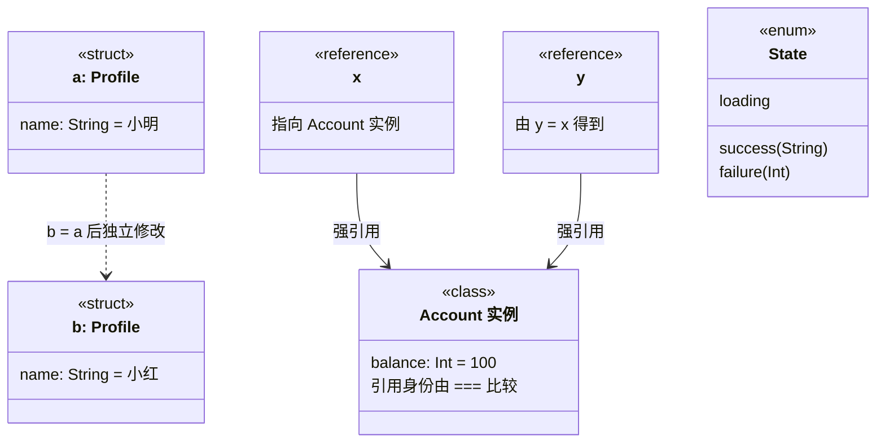

## 第 2 题

Optional 框展示两种 case；安全绑定与可选链框展示不同使用方式。as? 是产生可选结果的一种操作，转换失败得到 none。nickname 为空字符串时属于 some，而不是 none；?? 只在缺值时求默认值。

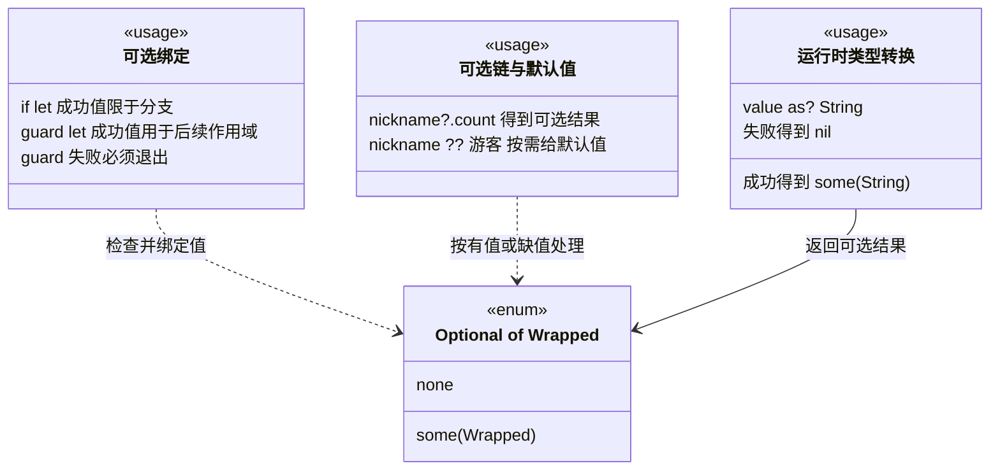

## 第 3 题

Meter 框区分保存值、计算访问和延迟初始化；Vehicle 与 Car 的空心三角表示真正的类继承。Car 可以重写 class name()，不能重写 static category()。类型存储属性与实例 lazy 的初始化保证不同，图内单独列出，初始化安全不等于后续所有读写都安全。

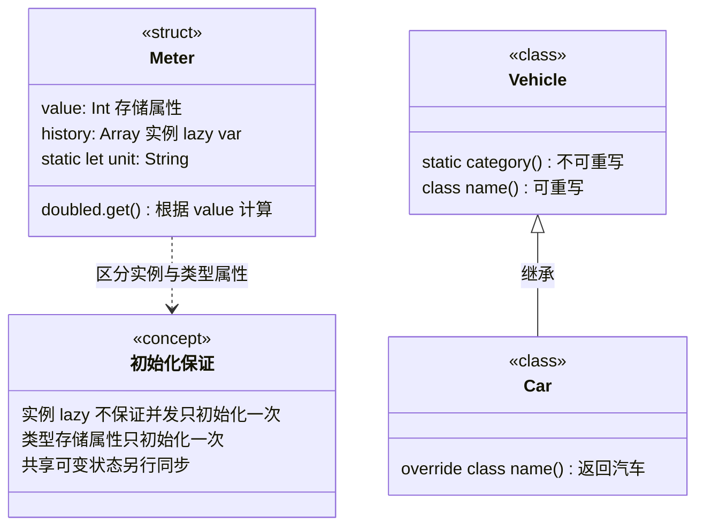

## 第 4 题

Vehicle 与 Car 表示真实继承关系，框内列出各自属性与初始化入口。Car 先赋 seats，再向上调用 Vehicle.init(name:)；Vehicle 的便利入口通过 self.init 横向委托。阶段框是初始化规则概览，不能在第一阶段尚未完成时读取完整 self 或调用实例方法。

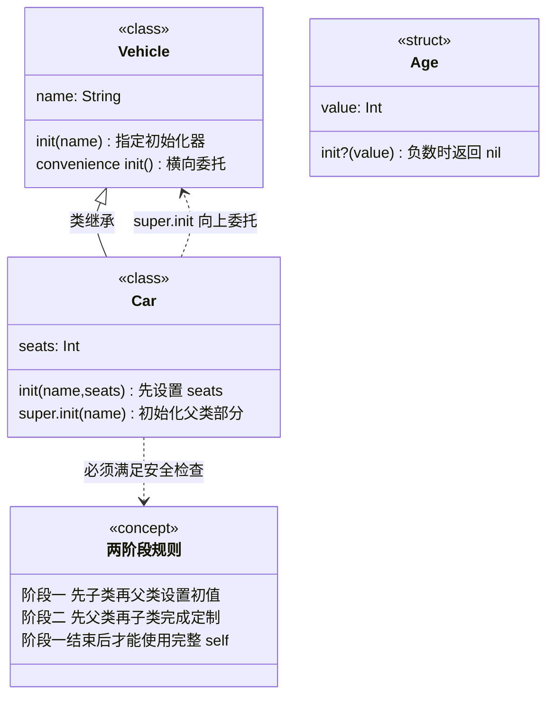

## 第 5 题

Page 强持有 onTap 闭包，闭包默认强捕获 self 时构成强引用环。CaptureList 表示替代捕获策略，并不是额外分配的业务对象：[weak self] 不保活且会清零；[unowned self] 不保活但依赖生命周期保证。是否使用弱捕获由实际所有权关系决定。

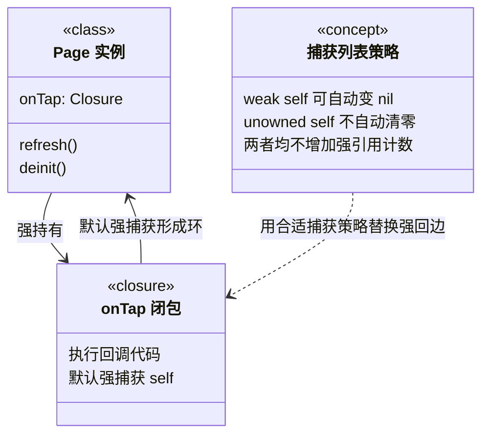

## 第 6 题

LiveCapture 和 SnapshotCapture 对应 readLive、readSnapshot：共享局部变量的前者读到 2，保存值快照的后者读到 1。参数规则框列出两个独立修饰维度。框名用于解释闭包与上下文，不表示 Swift 标准库存在这些同名类。

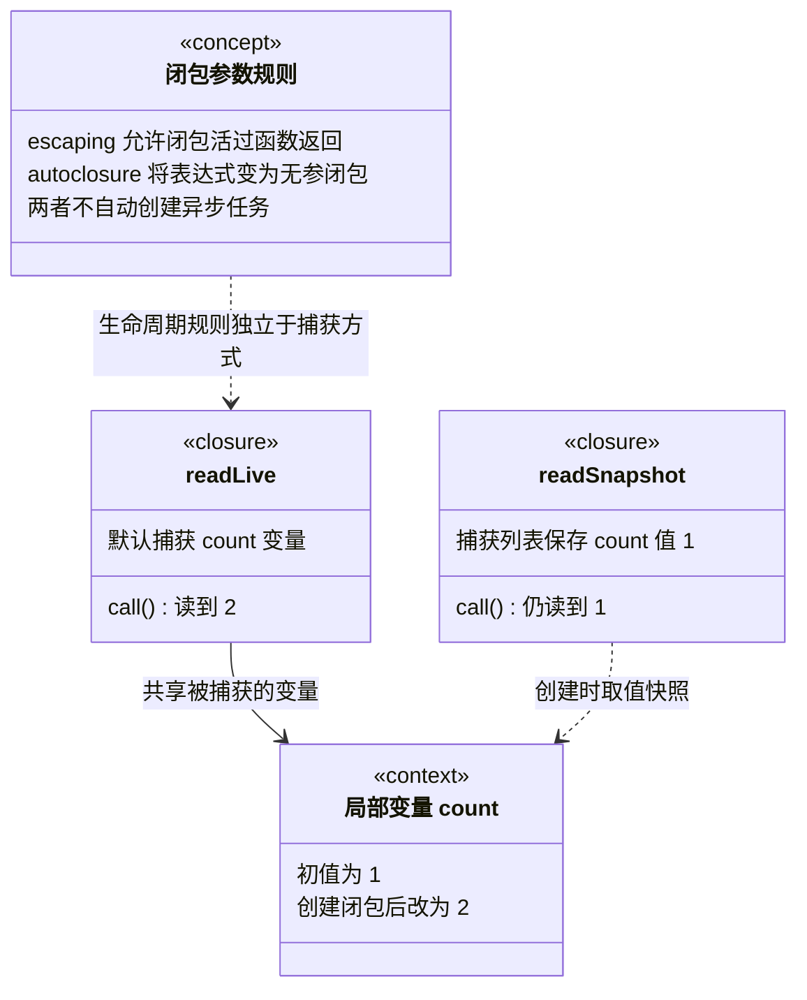

## 第 7 题

赋值后 a、b 是两个数组值，可关联同一份 Buffer；b.append(4) 在共享时先获得独立缓冲区再写，a 保持 [1,2,3]。Buffer 框是存储概念模型，具体地址可能被优化。Item 框说明：元素若是类引用，即使复制元素存储，也可能仍引用同一对象。

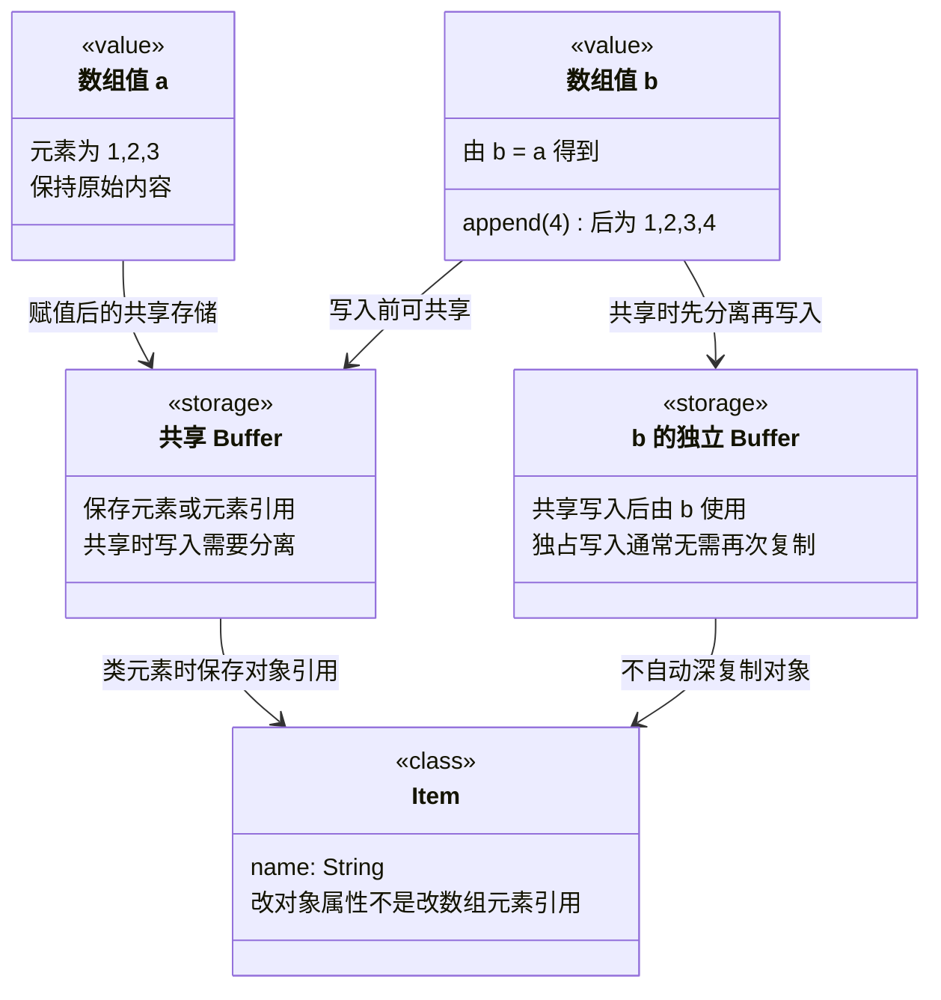

## 第 8 题

Input 和结果框使用页面相同的输入 1、x、3；map 保留 nil 的位置，compactMap 去掉失败项。Groups 框展示 flatMap 只拼接一层。这里列的是操作与结果类型，并不是三种实际的数组子类。

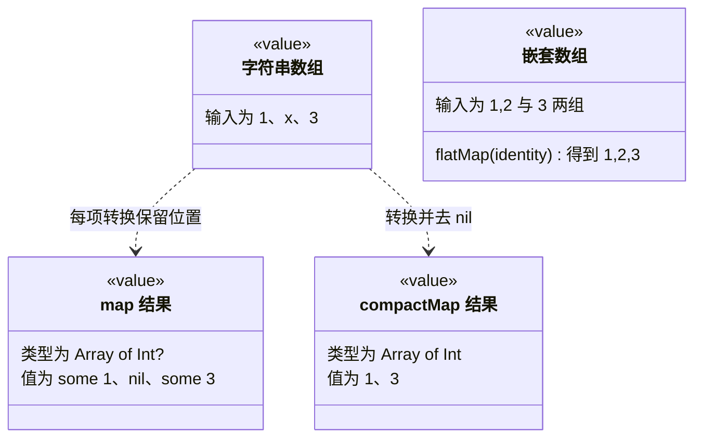

## 第 9 题

ThrowingFunction 是调用入口，调用策略框比较三种处理方式；Result 框列出两种枚举 case。defer 的规则单独放在作用域框中，它负责清理而非捕获错误，程序发生运行时终止时不能依赖它一定执行。

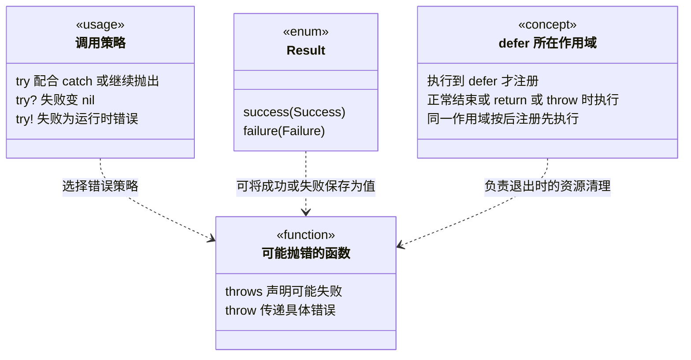

## 第 10 题

四个框分别表示语言机制。Generic 的 T 保持输入输出关系；OpaqueResult 对应本例 make() 始终返回 User；Existential 可先保存 User 再换 Book；Any 不保证 Named 能力。它们之间没有继承关系，框内签名仅为规则示意。

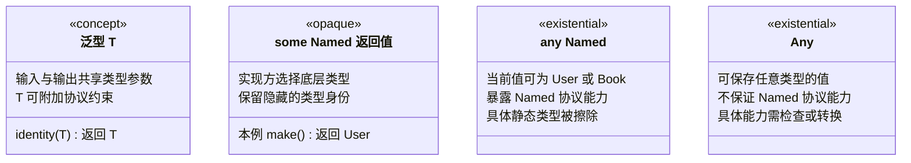

## 第 11 题

空心三角加虚线表示 User、Robot 遵循 Named；NamedExtension 通过依赖线为协议提供默认实现。show 只依赖 Named 要求：User 使用默认 greeting，Robot 使用自己的实现。协议与扩展的分离是示意，扩展不是可以实例化的父类。

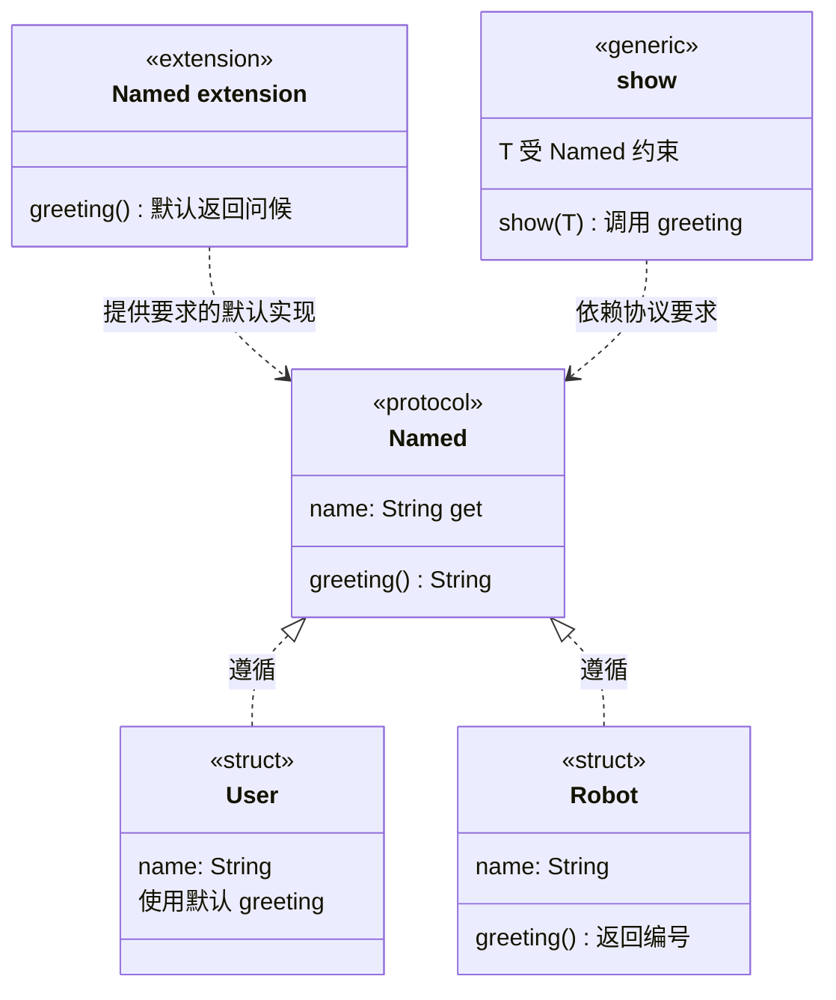

## 第 12 题

Greeter 只要求 hello；bye 位于扩展框。Person 虽然提供 hello、bye 两个同名成员，但协议视角 value 的 hello 通过遵循入口调用，bye 仍静态选扩展。具体类型 person.bye 则调用 Person.bye。虚线空心三角表示协议遵循，不把扩展画成父类。

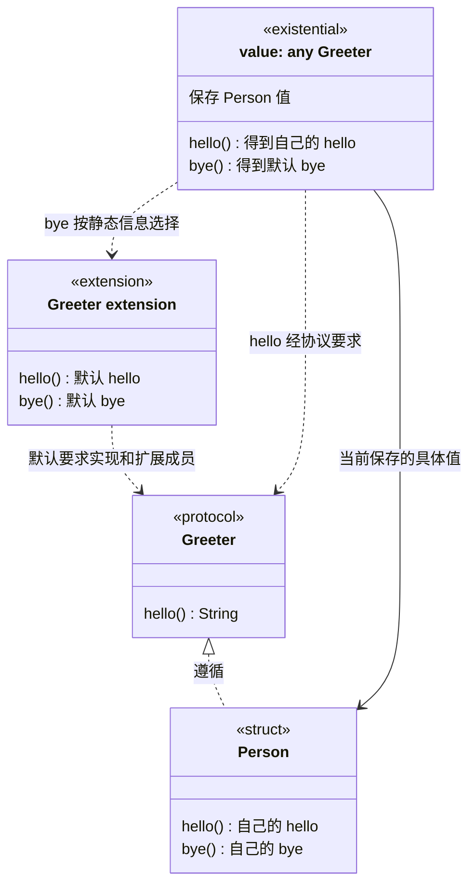

## 第 13 题

Dot 遵循原生 Drawable，并使用扩展提供的 draw；Button 遵循 @objc Clickable，却可以不实现 optional click。button.click?() 检查的是可选方法存在与否。本图两个空心三角都是协议遵循，NSObject 不是所有 Swift 协议遵循者必须具备的父类。

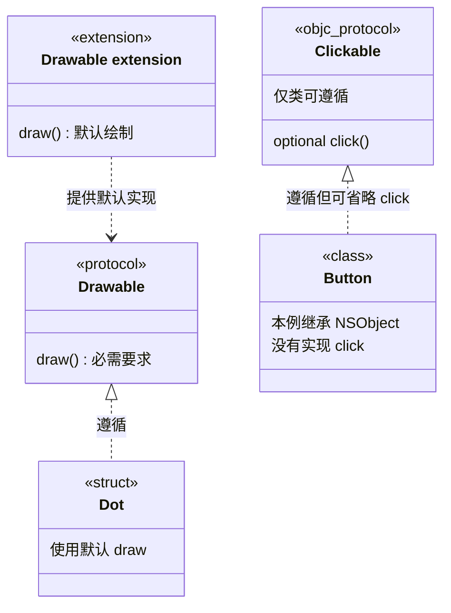

## 第 14 题

User 实际遵循的是 Encodable 与 Decodable，两者的组合名为 Codable，图中用两条遵循线表达。CodingKeys 将 JSON 的 display_name 映射到模型 name。编码器和解码器依赖模型各自的协议实现，并不是依靠反射直接给任意属性赋值。

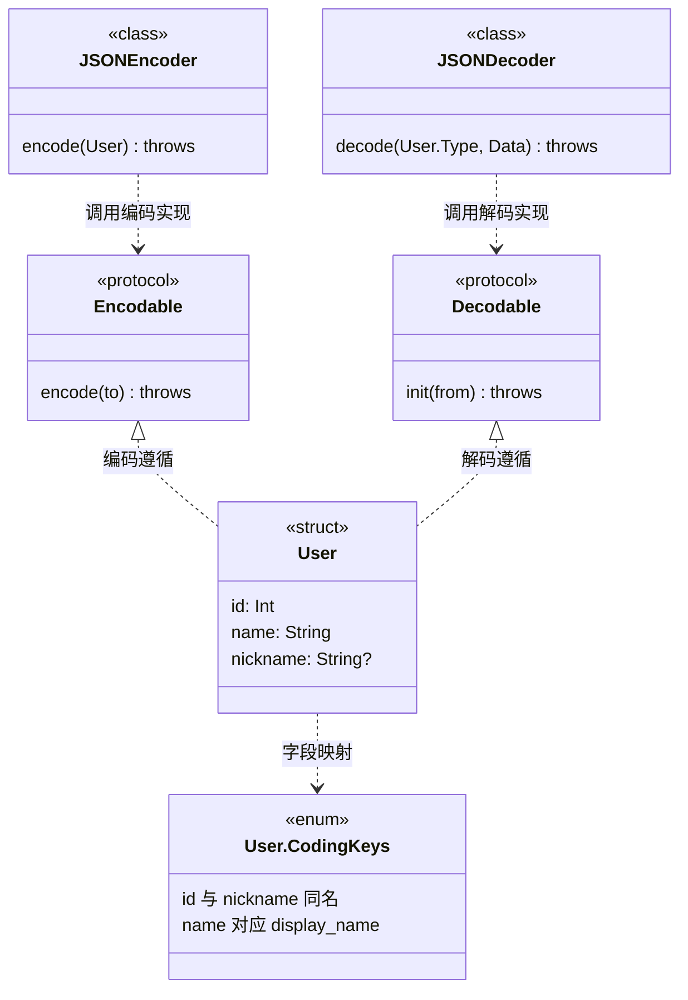

## 第 15 题

实例框以原生 Swift 对象概念模型列出对象头和属性，metadata 线指向同类共享的类元数据；虚表线关联方法入口。本题代码继承 NSObject，具体头部与引用计数表示还受父类及运行时影响。Person.self 只是类型值，不是新实例。OC 元类框仅适用于 Apple 互操作模型，图省略字段偏移、父类布局和旁表，不能据此手算对象地址。

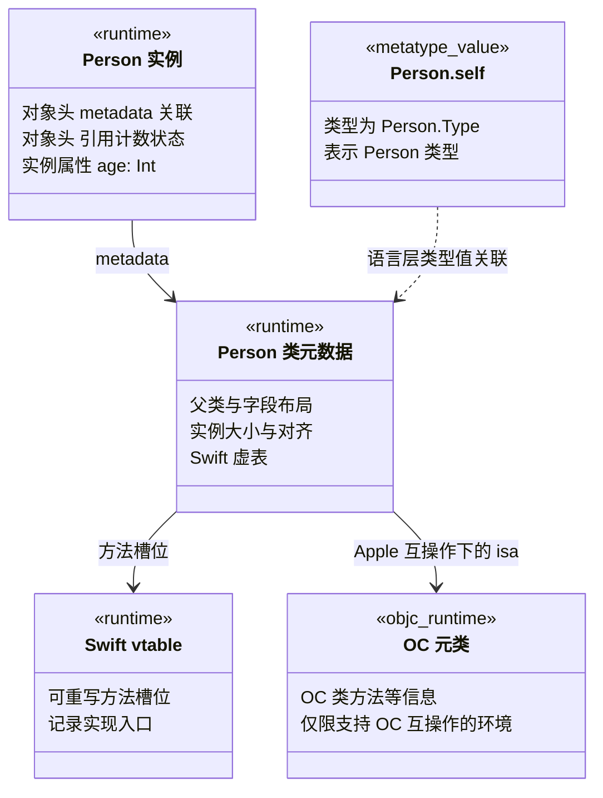

## 第 16 题

每个框列一条调用路径及其示例：animal.sound 通过实际 Dog 类虚表，speaker.speak 通过 Dog: Speaker 见证入口。静态框对应已知 final 目标；OC 框对应 @objc dynamic。方法实现可经适配入口继续转发，框之间不是类继承关系，也不表示固定性能排序。

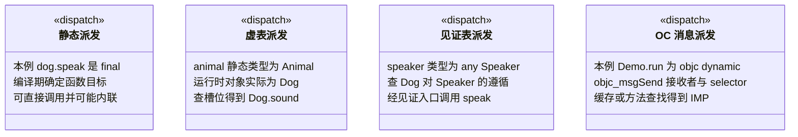

## 第 17 题

容器三个分区分别指向值存储、具体类型信息与协议见证表。非类限定、单个普通方法协议的典型 64 位 ABI 可用三字缓冲区加两个指针解释；这不是所有 any 的固定布局。协议描述符描述要求，见证表实现要求；关联线只表示语义关联，不暗示表的物理相邻位置。

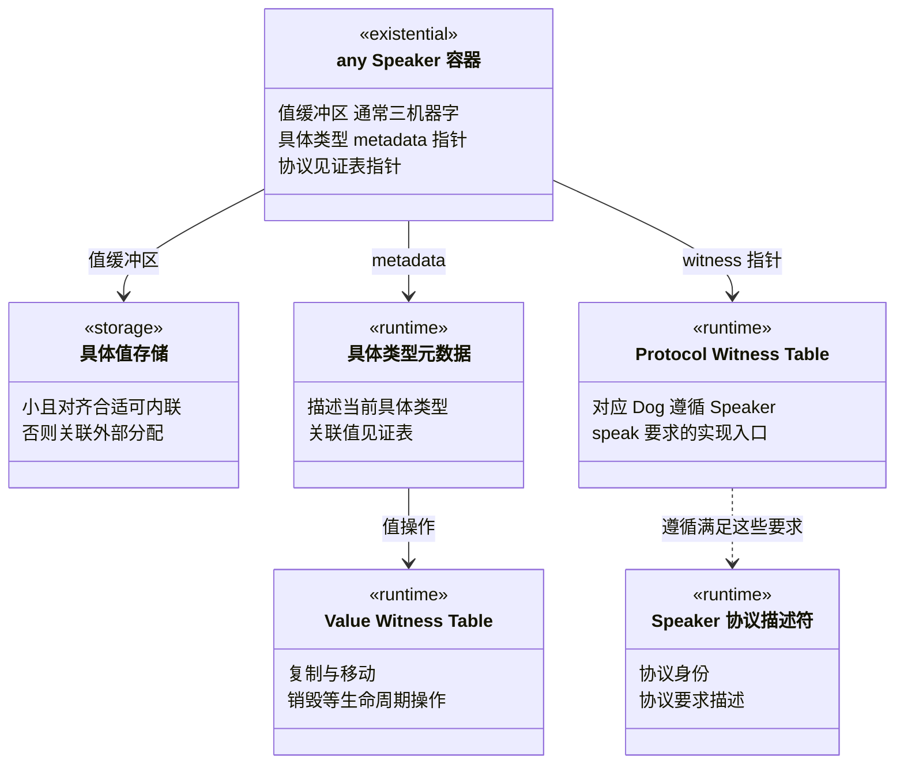

## 第 18 题

Task 是工作及其状态，Executor 负责调度，Thread 是执行资源；三者不是同一个概念。异步函数挂起后可恢复，普通任务并不固定绑定某条线程。GCD 队列调度 block，异步提交本身也不会让提交者等待，不能把 GCD 整体等同于阻塞。

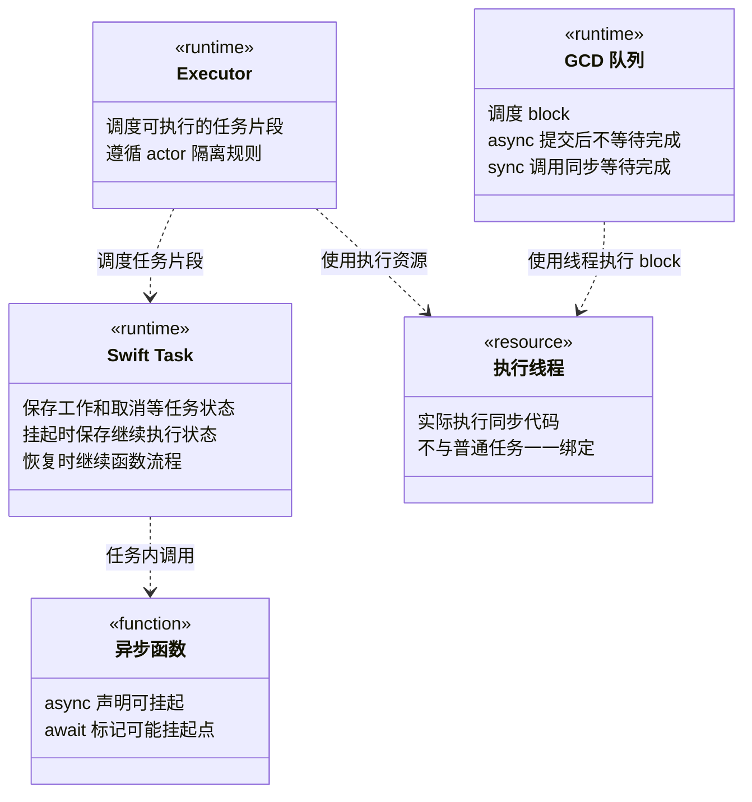

## 第 19 题

实线关联表示结构化父子关系与作用域等待，虚线表示创建非结构化任务，不能沿该线推断自动取消传播。TaskHandle 框区分发出 cancel 请求、检查取消以及 await value 等待完成，避免把“取消状态”与“任务结束”混为同一时刻。

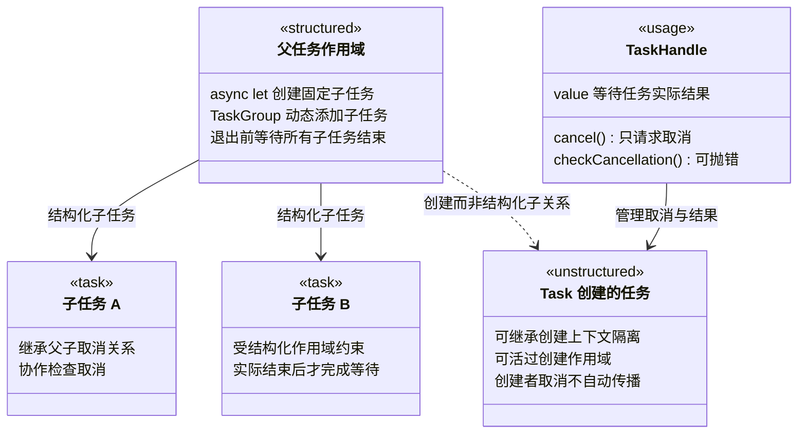

## 第 20 题

Counter 用 actor 隔离 value，increment 没有 await，读改写在一个隔离片段内完成；ScreenModel 通过 MainActor 隔离 UI 状态；Snapshot 以不可变 Int 满足 Sendable。虚线空心三角表示 Snapshot 的显式 Sendable 遵循。actor 自身也满足 Sendable，这不让其内部隔离属性可被外部直接读写。

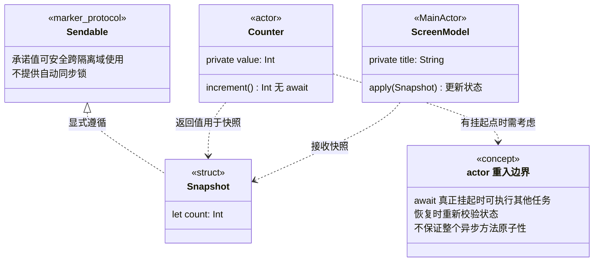

